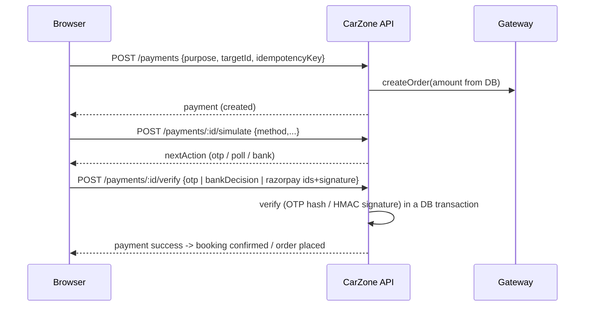

# CarZone – REST API

Base URL: `http://localhost:3000/api`. All requests and responses are JSON.
Served by an Express 4 router (`src/routes/index.js`); every URL, body and status below is
unchanged by the move to Express.

```
Success: { "ok": true,  "data": ... }
Error:   { "ok": false, "error": { "message": "...", "fields": { "email": "..." } } }
```
Status codes: 200/201 OK · 400 bad input or malformed JSON · 401 not logged in · 403 wrong role ·
404 not found (also any unknown `/api` URL: `Route not found: METHOD /path`) · 409 conflict
(slot full, out of stock, duplicate) · 413 body over 100 KB · 415 write sent without
`Content-Type: application/json` · 422 validation · 429 rate limited (`Retry-After` header).
All API responses carry `Cache-Control: no-store`.

Auth = session cookie `as_session` (HttpOnly) set by login/register.
**Auth column:** – public · C customer · U any logged-in user · A admin.
Money in responses is in **paise** (`totalPaise: 35282` = ₹352.82). Admin forms send rupees
for `price`, `mrp`, `minOrder`, `maxDiscount`; the server converts them.

---

## 1. Public

| Method | Path | Auth | Description |
|---|---|---|---|
| GET | `/health` | – | Health check for the hosting platform: `200 { status: 'ok', db: 'up', uptimeSeconds }` or `503 { status: 'ok', db: 'down' }` (plain JSON, no `ok/data` envelope) |
| GET | `/meta` | – | Business rules (GST, fees, cancel policy, shipping, payment gateway `simulated`/`razorpay`), company info, today |
| GET | `/services` | – | Active services with `prices` per vehicle type and `addons` |
| GET | `/services/:slug` | – | One service + approved reviews |
| GET | `/slots?date=YYYY-MM-DD` | – | `{ date, slots: [{ id, label, startTime, endTime, capacity, remaining, available, isPast, isBlocked }] }` |
| GET | `/offers?scope=wash\|store` | – | Live coupons |
| GET | `/reviews/featured` | – | Testimonials |
| POST | `/contact` | – (rate limited) | `{ name, email, phone?, subject, message }` |
| GET | `/store/categories` | – | Categories with `productCount` |
| GET | `/store/car-models` | – | `[{ id, make, model, bodyType }]` |
| GET | `/store/products` | – | Query: `search, category, carModelId, minPrice, maxPrice, minRating, inStock=1, sort (relevance\|price_asc\|price_desc\|rating\|discount\|newest), featured=1, deal=1` |
| GET | `/store/products/:slug` | – | Product + `compatibleModels`, `reviews`, `related` |
| POST | `/payments/webhook/razorpay` | signature | Razorpay webhook; header `X-Razorpay-Signature` = HMAC-SHA256(raw body, webhook secret). Body read with `express.raw()` so the exact bytes are verified |

## 2. Auth (`/api/auth`)

| Method | Path | Body | Result |
|---|---|---|---|
| POST | `/register` | `{ name, email, phone, password }` | `{ user, message }` + cookie |
| POST | `/login` | `{ email, password, remember? }` | `{ user, message }` + cookie; account locked for 15 min after 5 failures |
| POST | `/logout` | – | clears session |
| GET | `/me` | – | `{ user }` or 401 |
| POST | `/forgot-password` | `{ email }` | Always same message; `demoResetLink` when `DEMO_MODE=true` |
| POST | `/reset-password` | `{ token, password }` | |
| PUT | `/password` (U) | `{ currentPassword, newPassword }` | signs out other sessions |

## 3. Customer

| Method | Path | Auth | Body / notes |
|---|---|---|---|
| GET | `/me/dashboard` | C | Counters, next booking, offers |
| GET/PUT | `/me/profile` | U | `{ name, phone, address?, city?, pincode? }` |
| GET/POST | `/me/vehicles` | C | `{ vehicleType, brand, model, registrationNo, color? }` |
| PUT/DELETE | `/me/vehicles/:id` | C | |
| GET/POST | `/me/addresses` | C | `{ label, fullName, phone, line1, line2?, city, state, pincode, isDefault }` |
| PUT/DELETE | `/me/addresses/:id` | C | |
| POST | `/bookings/quote` | C | `{ serviceId, vehicleType, addonIds[], pickupDrop, couponCode? }` → `{ bill, addons, coupon }` |
| POST | `/bookings` | C | quote fields + `{ bookingDate, timeSlotId, address, instructions?, vehicleId? or brand/model/registrationNo, saveVehicle? }` → 201 `{ booking }` (status `pending_payment`); 409 if slot full |
| GET | `/bookings?scope=upcoming\|past\|all` | C | |
| GET | `/bookings/:id` | U (own / admin) | Detail with `addons`, `payments`, `history`, `refund`, `actions` |
| POST | `/bookings/:id/cancel` | U | `{ reason }` → refund by policy |
| POST | `/bookings/:id/reschedule` | C | `{ bookingDate, timeSlotId }` |
| GET | `/bookings/:id/invoice` | U | Printable GST invoice (HTML); `?download=1` |
| GET | `/cart` | C | `{ items, count, subtotalPaise, ... }` |
| POST | `/cart/merge` | C | `{ items: [{ productId, quantity }] }` (guest cart) |
| POST | `/cart/items/:productId` | C | `{ quantity }` add |
| PUT | `/cart/items/:productId` | C | `{ quantity }` set (0 removes) |
| DELETE | `/cart/items/:productId` | C | |
| GET | `/me/wishlist` | C | |
| POST/DELETE | `/me/wishlist/:productId` | C | |
| POST | `/orders/quote` | C | `{ couponCode?, fitment? }` → totals (subtotal, discount, shipping, fitment, total, GST included) |
| POST | `/orders` | C | `{ addressId, paymentMethod (card\|upi\|netbanking\|wallet\|cod), couponCode?, fitment?, fitmentDate?, fitmentSlotId? }` → 201 `{ order }`; 409 if stock insufficient |
| GET | `/orders` | C | Orders with `preview` |
| GET | `/orders/:id` | U | Items (`canReview`), history, payments |
| POST | `/orders/:id/cancel` | U | Before shipping; stock restored; refund if paid |
| POST | `/orders/:id/return` | C | Within `RETURN_WINDOW_DAYS` of delivery |
| GET | `/orders/:id/invoice` | U | HTML invoice |
| POST | `/reviews` | C | `{ bookingId, rating, title, comment }` (completed bookings) |
| GET | `/reviews/mine` | C | Service + product reviews |
| POST | `/store/products/:id/reviews` | C | `{ rating, title, comment }` (verified buyers only) |

## 4. Payments

| Method | Path | Auth | Body | Result |
|---|---|---|---|---|
| POST | `/payments` | C | `{ purpose: booking\|order, targetId, idempotencyKey }` — **no amount** (sending `amount` → 400) | `{ payment }` status `created`; Razorpay: `payment.checkout { keyId, orderId, amount, currency }` |
| POST | `/payments/:id/simulate` | C | `{ method, cardName/cardNumber/expiry/cvv \| upiId \| upiMode:'qr' \| bank \| wallet }` | `{ payment, nextAction: otp\|poll\|bank\|done\|failed, demoOtp? }` |
| POST | `/payments/:id/verify` | C | `{ otp }` or `{ bankDecision: approve\|decline }` or `{ razorpay_order_id, razorpay_payment_id, razorpay_signature }` | `{ payment }` success/failed; idempotent |
| GET | `/payments/:id/status` | C | – | `{ payment }` (UPI resolves after the pending period) |
| GET | `/payments` | C | – | My payment attempts |



## 5. Admin (`/api/admin`, role admin)

| Area | Endpoints |
|---|---|
| Analytics | `GET /analytics` — totals (wash/store revenue, success rate, low stock …), revenueByDay, bookingsByStatus, ordersByStatus, topServices, topProducts, paymentMethods, lowStock, recentActivity |
| Reports | `GET /reports/:type?from&to&format=json\|csv\|html` — types: bookings, revenue, customers, services, payments, sales, categories, orders, inventory |
| Users | `GET /users?search&role`, `POST /users`, `GET/PUT/DELETE /users/:id` |
| Bookings | `GET /bookings?status&date&search&from&to`, `GET /bookings/:id`, `PATCH /bookings/:id/status { status, note }` |
| Services | `GET/POST /services`, `PUT/DELETE /services/:id` (body incl. `prices: { sedan: '999', ... }`), `PATCH /services/:id/active { isActive }` |
| Add-ons | `GET/POST /addons`, `PUT/DELETE /addons/:id` |
| Coupons | `GET/POST /coupons`, `PUT/DELETE /coupons/:id` (`appliesTo` wash/store/both) |
| Slots | `GET/POST /slots`, `PUT/DELETE /slots/:id`, `GET /slots/day?date`, `PUT /slots/day { date, timeSlotId, capacity, isBlocked }` |
| Products | `GET /products?search&category&stock=low\|out`, `GET /products/low-stock`, `POST /products` (+`openingStock`), `GET/PUT/DELETE /products/:id`, `PATCH /products/:id/stock { change, note }` |
| Catalogue | `GET /car-models`, `GET/POST /categories`, `PUT/DELETE /categories/:id` |
| Orders | `GET /orders?status&search`, `GET /orders/:id`, `PATCH /orders/:id/status { status, note }` — allowed: placed→packed→shipped→out_for_delivery→delivered, placed/packed→cancelled, return_requested→returned\|delivered |
| Product reviews | `GET /product-reviews?status`, `PATCH /product-reviews/:id { status }`, `DELETE /product-reviews/:id` |
| Payments | `GET /payments?status&method&gateway&purpose&search`, `GET /payments/:id` |
| Refunds | `GET /refunds?status`, `POST /refunds/:id/process` |
| Reviews | `GET /reviews?status`, `PATCH /reviews/:id { status, adminReply }`, `DELETE /reviews/:id` |
| Messages | `GET /messages?status`, `PATCH /messages/:id { status }`, `DELETE /messages/:id` |

## 6. Examples

```bash
# Log in (saves the cookie) and add a product to the cart
curl -c c.txt -H "Content-Type: application/json" -d '{"email":"rohan@example.com","password":"Customer@123"}' http://localhost:3000/api/auth/login
curl -b c.txt -X POST -H "Content-Type: application/json" -d '{"quantity":1}' http://localhost:3000/api/cart/items/1
# Admin CSV report
curl -b admin.txt "http://localhost:3000/api/admin/reports/sales?from=2026-01-01&to=2026-12-31&format=csv"
```
